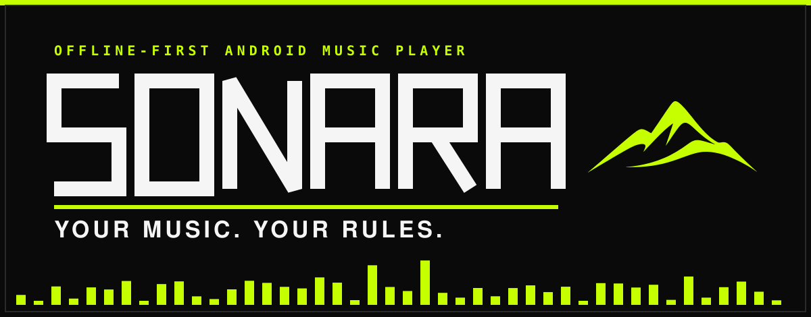
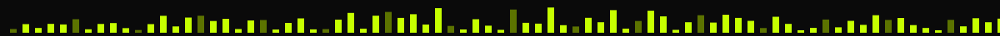
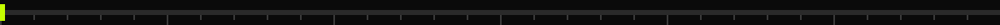
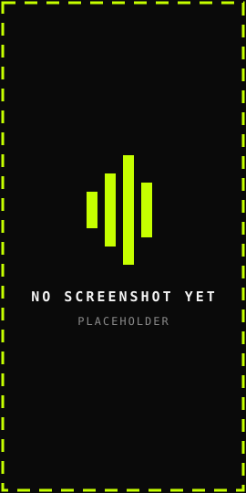
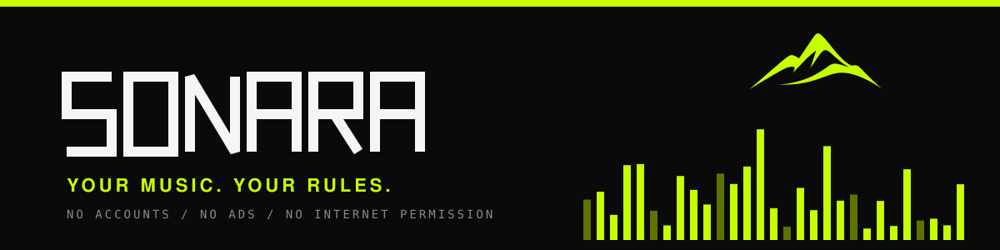

<div align="center">



<br>


<br><br>

**A music player that plays your music, and nothing else.**<br>
No accounts. No ads. No internet permission. Just the files on your phone, in a dark, sharp, acid-lime interface.

<br>



</div>

## 01 / About

SONARA is a native Android music player built around one idea: **your library already lives on your device, so the
app should never need to leave it.** It reads the audio your phone already knows about, keeps a fast local copy, and
gets out of the way. The design is deliberately uncompromising: near-black surfaces, hard edges, strong type and one
accent colour, with motion that is physical and interruptible instead of decorative.

- **Offline by construction.** The app does not request the `INTERNET` permission at all.
- **Yours to rearrange.** Playlists, a permanent Favourite playlist, excluded folders, six accent colours.
- **Careful with your library.** A failed or partial scan can never wipe your library, and excluding a folder never
  deletes anything you made.

<div align="center"></div>

## 02 / Features

Everything in this table exists in the code today. Items that do not are listed under [Status](#04--status).

<table>
<tr>
<td width="50%" valign="top">

**LIBRARY**<br>
Local discovery through MediaStore, with a safe incremental rescan. Browse Songs, Albums, Artists, Genres and Folders;
open an album or artist for its own page.

</td>
<td width="50%" valign="top">

**SEARCH**<br>
One search across songs, albums, artists, playlists and folders. Every word must match, results are ranked, and a
failed search has a Retry.

</td>
</tr>
<tr>
<td valign="top">

**PLAYLISTS**<br>
Create, rename, reorder and delete. Multi-select song picker and EDIT mode. A permanent system **Favourite**
playlist behind the heart button that cannot be renamed or deleted.

</td>
<td valign="top">

**PLAYER**<br>
A mini-player that physically grows into the full player. Seek, shuffle, repeat (off, all, one), queue panel, and a
queue that is restored after a restart.

</td>
</tr>
<tr>
<td valign="top">

**BACKGROUND PLAYBACK**<br>
A media-playback foreground service with notification and lock-screen controls, headset and Bluetooth media buttons,
audio focus, and pause when headphones are unplugged.

</td>
<td valign="top">

**EQUALIZER**<br>
Reads the bands, ranges and presets your device actually supports. If the device has no equalizer, the screen says so
instead of showing dead controls.

</td>
</tr>
<tr>
<td valign="top">

**ACCENT COLOURS**<br>
Six contrast-checked accents. The choice reaches every screen, the player, the equalizer and the navigation
indicator.

</td>
<td valign="top">

**MOTION**<br>
Startup reveal, directional navigation, press feedback and artwork transitions. **Full**, **Reduced** or **Off**, and
it also follows Android's own animation scale.

</td>
</tr>
</table>

Also in Settings: remember queue, play next automatically, haptics, excluded folders, storage and cache sizes with
clear buttons, notification status and open-source licences.

<div align="center"></div>

## 03 / Screenshots

No screenshots have been added to the repository yet, so the frames below are **placeholders**, not the app.

<table>
<tr>
<td align="center"><br><sub>HOME</sub></td>
<td align="center"><br><sub>LIBRARY</sub></td>
<td align="center"><br><sub>FULL PLAYER</sub></td>
<td align="center"><br><sub>PLAYLISTS</sub></td>
</tr>
</table>

<div align="center"></div>

## 04 / Status

SONARA V1.0 is **not released yet.** The current build is `1.0.0-m7`.

| Milestone | Scope | State |
|---|---|---|
| M1 to M1.2 | Foundation, motion tokens, directional navigation, page-strip tabs | Delivered, device-tested by the author |
| M2 | Permissions, MediaStore scan, Room cache, Media3 service, notification and lock-screen controls | Delivered, device-tested (Bluetooth disconnect not tested) |
| M3 to M3.1 | Home, Library, Search, Folders, detail screens, official logo and launcher icon | Delivered, device-tested |
| M4 to M5.2 | Playlists, permanent Favourite, mini-player, full player, queue | Delivered, device-tested |
| M6.1 | Equalizer | Delivered; sound on each audio output not separately confirmed |
| M6.2 | Expanded Settings, safe rescan, excluded folders, accent colours | Delivered, device-tested |
| M7 | Motion and polish | Delivered, device-tested |
| **M6.3** | **Local lyrics (embedded and `.lrc`), Sleep Timer, History screen** | **Pending. Not built yet.** |
| M8 | QA and release: signed build, large-library checks, final device verification | In progress. Release is on hold until M6.3 is done and verified |

Play history is already recorded in the database and feeds "recently played" on Home; the dedicated **History screen**
does not exist yet.

**What has been checked, and how.** Unit tests run in GitHub Actions on every push. Library-size checks for 100,
1,000 and 5,000 tracks cover the pure logic (search, sorting, scan diff, tag clean-up) on the JVM. They do not measure
phone speed. Nothing in this project has been profiled or benchmarked on a device, so no frame-rate or smoothness
claim is made.

<div align="center"></div>

## 05 / Tech stack

| Layer | Used |
|---|---|
| Language | Kotlin 2.2.20 |
| UI | Jetpack Compose (BOM 2025.06.01), Material 3 components, custom design system |
| Playback | AndroidX Media3 1.7.1: ExoPlayer and MediaSession |
| Storage | Room 2.8.1 (library cache, playlists, history, queue), DataStore Preferences 1.1.7 (settings) |
| Async | Kotlin coroutines and Flow |
| Navigation | Navigation Compose, with custom push, pop and tab-strip transitions |
| Build | Android Gradle Plugin 8.13.0, KSP, Gradle wrapper, JDK 17 |
| Platform | minSdk 31 (Android 12), compileSdk and targetSdk 36 |

## 06 / Architecture

```
 MediaStore ──scan──▶ LibraryRepository ──▶ Room ──Flow──▶ ViewModels ──▶ Compose screens
                          (safe diff)      (cache, playlists,                 (SonaraTheme:
                                            history, queue)                    colour, type, motion)
 Compose screens ──▶ PlaybackController ──MediaController──▶ PlaybackService
                                                              ExoPlayer + MediaSession
                                                              (notification, lock screen, media buttons)
 DataStore ──▶ SettingsRepository ──▶ accent, motion level, playback and library preferences
```

- **One owner of playback.** `PlaybackService` holds the only player. Screens talk to it through a controller, so
  music keeps playing without any screen.
- **Room is a cache of MediaStore**, never the source of truth. Playlists and history refer to tracks by id, so a track
  that disappears shows as unavailable and comes back when the file does.
- **Motion is centralised.** Every duration, easing and distance lives in one token set, resolved against the in-app
  setting and the system animation scale.

Package layout, behaviour notes and the per-milestone engineering record are in
[`docs/TECHNICAL.md`](docs/TECHNICAL.md).

<div align="center"></div>

## 07 / Build

**Requirements:** JDK 17, Android Studio with Android SDK Platform 36, and a device or emulator on Android 12 (API 31)
or newer. The Gradle wrapper is included; no global Gradle install is needed.

```bash
./gradlew :app:testDebugUnitTest   # JVM unit tests
./gradlew :app:assembleDebug       # debug APK  -> app/build/outputs/apk/debug/
./gradlew :app:assemblePerf        # optimised, debug-signed build for judging smoothness
./gradlew :app:lintDebug           # Android lint
```

In Android Studio, open the repository root, let Gradle sync, choose the `app` configuration and run.
Judge scrolling and animation on the `perf` build, because debug builds run Compose unoptimised.

GitHub Actions (`SONARA CI`) runs the tests and builds on every push and uploads the debug and perf APKs.
Signed release builds use a separate manual workflow; see [`docs/RELEASE.md`](docs/RELEASE.md). **Signing keys and
passwords are never stored in the repository.**

## 08 / Roadmap

1. **M6.3:** local lyrics, Sleep Timer and the History screen.
2. **M8:** final QA, large-library and device verification, then a signed V1.0 release.

Nothing beyond V1.0 is planned in this repository yet.

<div align="center"></div>

## 09 / Credits and licence

- **Licence:** this repository does not contain a licence file yet, so no licence is granted for SONARA's own code
  until one is added.
- **Logo:** the SONARA mountain mark is traced from `branding/sonara-logo-source.webp`, the logo supplied by the
  project owner.
- **Open source:** SONARA is built with Jetpack Compose and Material 3, AndroidX (Activity, Core, Lifecycle,
  Navigation, Room, DataStore, Media3), Guava, and Kotlin with kotlinx.coroutines. All are licensed under the Apache
  License 2.0 and are also listed inside the app under Settings, About, Open-source licences.

<br>


